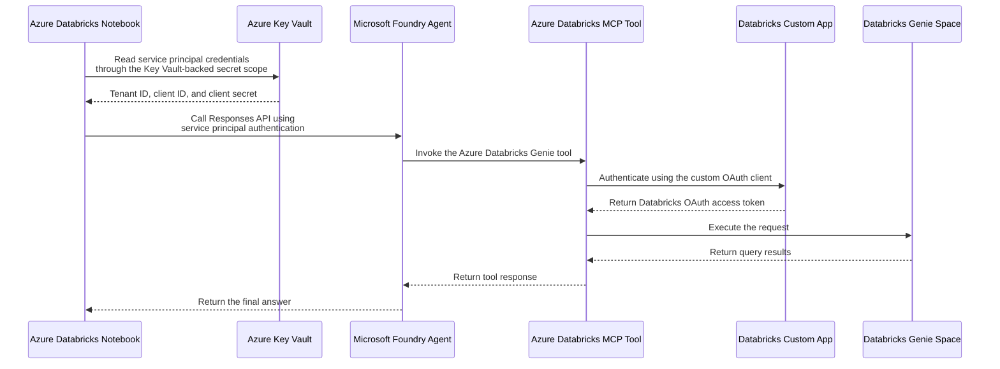

# Calling Azure AI Foundry Models and Agents from Azure Databricks

## Overview
Models and agents deployed in Microsoft Foundry are not always registered in Azure Databricks Unity Catalog. This repository demonstrates how Azure Databricks notebooks can integrate with those Foundry resources through three model workflows and one agent workflow:

1. Call a Foundry model deployment directly with the OpenAI SDK and Microsoft Entra service principal authentication.
2. Register a Foundry model as a Databricks external model serving endpoint using a Foundry resource key, then query it with `ai_query()`.
3. Call a Foundry model through a Databricks AI Gateway model provider service.
4. Call a Foundry Agent and use its Azure Databricks MCP tool, authenticated through a Databricks Custom App, to query a Genie space.

Together, the notebooks cover direct API access, Databricks Model Serving, AI Gateway, Foundry Agents, Key Vault-backed secrets, service principals, resource keys, and custom OAuth authentication.

## Notebooks

### 1) Call Foundry Deployment Directly
This notebook calls an Azure AI Foundry deployment directly from a Databricks notebook, without using Databricks Model Serving.

It acquires a Microsoft Entra ID token using service principal credentials stored in an [Azure Key Vault-backed secret scope](https://learn.microsoft.com/en-us/azure/databricks/security/secrets/#akv-ss). The notebook uses the client credentials flow for `https://cognitiveservices.azure.com/.default`, then uses the `AzureOpenAI` client to submit a chat completion request to the Foundry endpoint.

**Use case:** This approach provides a workaround for environments where Databricks Model Serving cannot resolve Key Vault-backed secrets for Microsoft Entra token acquisition when calling Azure AI Foundry endpoints.

**Prerequisite:** A Microsoft Entra service principal with the **Cognitive Services OpenAI User** RBAC role on the Azure AI Foundry resource.

### 2) Register Foundry Model - API/Resource Key
This notebook registers an Azure AI Foundry deployment as a Databricks external model serving endpoint using the MLflow deployments client (`mlflow.deployments`).

Authentication uses a Foundry resource key stored in a Databricks-backed secret scope. This is required because Model Serving cannot authenticate a Microsoft Entra service principal in this scenario.

The notebook covers three steps:
1. Create the endpoint. When the operation is complete, the model name appears in the Azure Databricks Serving Endpoints list. For more information, see [Create custom model serving endpoints](https://learn.microsoft.com/en-us/azure/databricks/machine-learning/model-serving/create-manage-serving-endpoints).
2. Verify the endpoint.
3. Validate the endpoint with a sample `ai_query()` SQL call.

A utility cell is also included to delete and recreate the endpoint when configuration updates are needed.

Prerequisites:
- A Databricks-backed secret scope that contains the Foundry API key. For more information, see [Create a Databricks-backed secret scope](https://learn.microsoft.com/en-us/azure/databricks/security/secrets/#create-a-databricks-backed-secret-scope).
- A model deployed in Azure AI Foundry with a known deployment name and API version. For more information, see [Authenticate with a Foundry resource key](https://learn.microsoft.com/en-us/azure/ai-services/authentication#authenticate-with-a-foundry-resource-key).

> **Note:** The Foundry resource key is required only for the **Register Foundry Model - API/Resource Key** example.

### 3) Call Foundry Model from AI Gateway Provider
This notebook calls a Microsoft Foundry model through Databricks AI Gateway using a model provider service and the OpenAI SDK.

Authentication to Databricks uses the notebook's built-in session token, so no credentials are hardcoded in the notebook. The provider service routes the request to the Foundry deployment using Azure service credentials.

Prerequisites:
- A model deployed in Microsoft Foundry.
- A Databricks model provider service configured with Azure service credentials. For more information, see [Create model provider services with Azure service credentials](https://learn.microsoft.com/en-us/azure/databricks/ai-gateway/create-model-provider-services#azure-service-credential).

### 4) Call Foundry Agent
This notebook calls a Microsoft Foundry Agent from Azure Databricks using the `azure-ai-projects` SDK and the OpenAI Responses API. The agent connects to a Databricks Genie space through an MCP tool to answer questions.  

This workflow uses two separate forms of authentication:
- **Foundry tool authentication:** A custom OAuth connection backed by an Azure Databricks Custom App allows the Foundry Agent to call the Databricks Genie space.
- **Notebook authentication:** A Microsoft Entra service principal, whose credentials are stored in an Azure Key Vault-backed secret scope, allows the notebook to call the Foundry Agent. This service principal requires the appropriate RBAC role on the Foundry resource.

> **Note:** On the first run, the response may include an OAuth consent link. Open the link to authorize the Foundry Agent's connection to Databricks, then run the request again.

Prerequisites:
- A Foundry Agent configured with an Azure Databricks Genie MCP tool that connects to a Databricks Genie space through a custom OAuth provider.
- A Databricks Custom App created in the Account Console, with its credentials configured on the Foundry Agent's MCP tool.
- A Microsoft Entra service principal with the **Cognitive Services OpenAI User** RBAC role on the Foundry resource. The notebook uses this identity, which is separate from the Custom App used by the Azure Databricks Genie MCP tool.
- An Azure Key Vault-backed Databricks secret scope containing the tenant ID, client ID, and client secret for the notebook's service principal.

Complete the following steps to configure the first two prerequisites:

1. Go to the [Databricks Account Console](https://accounts.azuredatabricks.net). Select **Settings** > **App Connections** > **Custom Apps**, then select **Add Connection**. Complete the fields as shown below. Use a placeholder for the redirect URL; you will replace it after creating the custom OAuth connection in the Foundry tool.

    

    > **Note:** Record the **Client ID** and **Client Secret** displayed on the connection confirmation screen. You will use them in the next step.

2. In **Microsoft Foundry**, create the tool that will connect to the Databricks Genie space. From the left navigation, select **Build** > **Tools** > **Connect a tool**. Open the **Catalog** tab, select **Azure Databricks Genie**, and then select **Create**.

3. Enter the tool **Name**, `genie_space_id`, and `workspace-hostname`. Under **OAuth provider**, select **Custom**, enter the following values, and then select **Connect**:

    - **Client ID:** The client ID generated in step 1
    - **Client Secret:** The client secret generated in step 1
    - **Token URL:** `https://<workspace-hostname>/oidc/v1/token`
    - **Auth URL:** `https://<workspace-hostname>/oidc/v1/authorize`
    - **Refresh URL:** The same value as the token URL
    - **Scopes:** `all-apis offline_access`

    > **Note:** Record the **Redirect URL** displayed on the credential provider confirmation screen. You will use it in the next step.

4. Return to the [Databricks Account Console](https://accounts.azuredatabricks.net) and select **Settings** > **App Connections** > **Custom Apps**. Open the custom app you created, replace the placeholder in the **Redirect URLs** field with the redirect URL from step 3, and save the connection.

## Getting Started
1. Clone or fork this repository, then import the notebooks into your Azure Databricks workspace using Databricks Git folders. For more information, see [Azure Databricks Git folders](https://learn.microsoft.com/en-us/azure/databricks/repos/).
2. Update the notebook settings with your own deployed model details (deployment name, endpoint, API version, and authentication values).

## Example Model in This Repo
The examples were originally authored using a deployed `gpt-6-luna` model in AI Foundry.

You should deploy a model in your own Azure AI Foundry project and replace the sample values with your environment-specific details.
