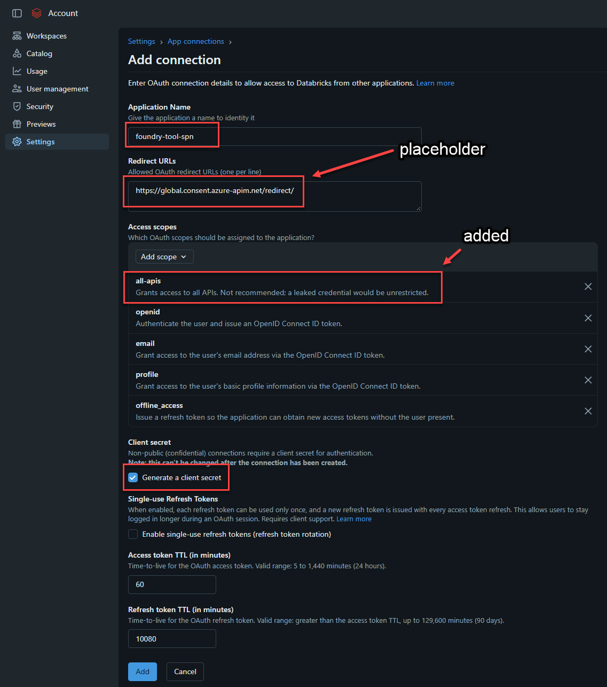

# Calling Azure AI Foundry Models from Azure Databricks

## Overview
There has been much discussion of being able to call AI Foundry models from Azure Databricks.  The reason for this is that there may be a model deployed in AI Foundry that is not listed as a registered model within Unity Catalog. 

This repository demonstrates four ways to call deployed Azure AI Foundry models and agents from Azure Databricks.

## Notebooks

### 1) Call Foundry Deployment Directly
This notebook calls an Azure AI Foundry deployment directly from a Databricks notebook, without using Databricks Model Serving.

It acquires a Microsoft Entra ID token using service principal credentials (client credentials flow for `https://cognitiveservices.azure.com/.default`) stored in an [Azure Key Vault-backed secret scope](https://learn.microsoft.com/en-us/azure/databricks/security/secrets/#akv-ss), then uses the `AzureOpenAI` client to submit a chat completion request to the Foundry endpoint.

Use case:
Workaround for environments where Databricks Model Serving cannot resolve Key Vault-backed secrets for Entra token acquisition when calling Azure AI Foundry endpoints.

Prerequisite:
An Azure Service Principal created that must have the **Cognitive Services OpenAI User** RBAC role on the Azure AI Foundry resource.

### 2) Register Foundry Model - API/Resource Key
This notebook registers an Azure AI Foundry deployment as a Databricks external model serving endpoint using the MLflow deployments client (`mlflow.deployments`).

Authentication uses an Azure Foundry Resource key stored in a Databricks-backed secret scope. This is required because Model Serving cannot authenticate an Azure Service Principal in this scenario.

The notebook covers three steps:
1. Creates the endpoint. When completed, you will see the model name in the Serving Endpoints listing within Azure Databricks. 
For more on this topic, check out [Create custom model serving endpoints](https://learn.microsoft.com/en-us/azure/databricks/machine-learning/model-serving/create-manage-serving-endpoints)
2. Verifies the endpoint.
3. Validates the endpoint with a sample `ai_query()` SQL call.

A utility cell is also included to delete and recreate the endpoint when configuration updates are needed.

Prerequisites:
- A Databricks-backed secret scope that contains the Foundry API key. 
For more on this topic, check out [Create a Databricks-backed secret scope](https://learn.microsoft.com/en-us/azure/databricks/security/secrets/#create-a-databricks-backed-secret-scope)
- A deployed model in Azure AI Foundry with a known deployment name and API version. 
For more on this topicNOTE:  This is only needed for the Register Foundry Model - API/Resource Key example 
For more on this topic, check out [Authenticate with a Foundry resource key](https://learn.microsoft.com/en-us/azure/ai-services/authentication#authenticate-with-a-foundry-resource-key)

### 3) Call Foundry Model from AI Gateway Provider
This notebook calls a Microsoft Foundry model through Databricks AI Gateway using a model provider service and the OpenAI SDK.

Authentication to Databricks uses the notebook's built-in session token, so no credentials are hardcoded in the notebook. The provider service routes the request to the Foundry deployment using Azure service credentials.

Prerequisites:
- A model deployed in Microsoft Foundry.
- A Databricks model provider service configured with Azure service credentials. 
For more on this topic, check out [Create model provider services with Azure service credentials](https://learn.microsoft.com/en-us/azure/databricks/ai-gateway/create-model-provider-services#azure-service-credential).

### 4) Call Foundry Agent
This notebook calls a Microsoft Foundry Agent from Azure Databricks using the `azure-ai-projects` SDK and the OpenAI Responses API. The agent connects to a Databricks Genie space through an MCP tool to answer questions.  

There are two different forms of authentication utilized here:
- Azure Foundry Custom OAuth connection used in the Foundry Tool.  It is a service principal generated by a custom Azure Databricks App.  It is needed for AI Foundry to call the Azure Databricks Genie Space.    
- Notebook - Authentication uses a Microsoft Entra service principal whose credentials are stored in an Azure Key Vault-backed secret scope.  This is utilized to call the Foundry Agent and needs the proper RBAC roles to interact with AI Foundry from Databricks.
NOTE:  On the first run, the response may include an OAuth consent link that must be opened to authorize the agent's connection to Databricks before running the request again.

Prerequisites:
- A Foundry Agent configured with an Azure Databricks Genie MCP tool that connects to a Databricks Genie space using a Custom OAuth Provider / Azure Service Principal.
- A Databricks Custom App created in the Account Console, with its credentials configured on the Foundry Agent's MCP tool.
- An Azure service principal with the **Cognitive Services OpenAI User** RBAC role on the Foundry resource that is utilized in the Notebook.  This is a different SPN than utilized by the Azure Databricks Genie MCP tool .
- An Azure Key Vault-backed Databricks secret scope containing the service principal tenant ID, client ID, and client secret that is used in the Notebook.

For the first two Prerequisite items above, there are a few steps to do in the following order so that everything performs as expected.  
1.  Go the [Databricks Admin Console](https://accounts.azuredatabricks.net) and click on **Settings** | **App Connections** tab and click **Custom Apps** and then **Add Connection**.  Fill out the fields as listed in the screen shot below. You will not be able to generate a Redirect URL yet.  We will come back to this once we complete the Custom OAuth connection in the Foundry tool.

    
    NOTE:  Make sure to capture the **Client ID** and **Client Secret**  on the Connection created confirmation screen.  We will use this in the next step.

2.  Within **AI Foundry** we need to create the tool that will connect to the Databricks Genie Space.  Go to **Build** and then **Tools** along the left navigation bar and click **Connect a tool** and click the **Catalog** tab and select **Azure Databricks Genie** and click **Create**.

3. FIll out the Name, genie_space_id and workspace-hostname.  Under **OAuth provider** select **Custom** and use the following values and click **Connect:** 
    **Client ID** = The Client ID generated from Step 1 
    **Client Secret** = The Client Secret Generate from Step 1 
    **Token URL** = https://<worksapce-hostname>/oidc/v1/token 
    **Auth URL** = https://<worksapce-hostname>/oidc/v1/authorize 
    **Refresh URL** = Same as Token URL above 
    **Scopes** = all-apis offline_access 

    NOTE: Make sure to capture the **Redirect URL** on the You've created a credential provider confirmation screen as we will need that for the next step.

4. Go back to the  Go the [Databricks Admin Console](https://accounts.azuredatabricks.net) and click on **Settings** | **App Connections** tab and the custom app you just created and add the **Redirect URL** from the previous step to the **Redirects URL** box.  Replace the placeholder value we used before.

5. Within the Databricks Genie Space, click **Share** and make sure that the SPN created in Azure Entra ID as a result of the steps 2 and 3 is given **Can Run** permission on the Genie Space.  The SPN created in Azure Entra ID will have the following name construct:  <AI Foundry Project Name>-resource-<AI Foundry Project Name>-<AI Foundry Tool Name>-AgentIdentity.   
For example I have the following name:  jebws-resource-jebws-Databricks-F1-AgentIdentity 
NOTE:  You will need to add it to the 

## Getting Started
1. Clone this repository to your GitHub account and add import these notebooks into your Databricks workspace using Databricks Git folders.  
For more on this topic, check out [Azure Databricks Git folders](https://learn.microsoft.com/en-us/azure/databricks/repos/).
2. Update the notebook settings with your own deployed model details (deployment name, endpoint, API version, and authentication values).

## Example Model in This Repo
The examples were originally authored using a `gpt-6-luna` deployed model within AI Foundry.

You should deploy a model in your own Azure AI Foundry project and replace the sample values with your environment-specific details.
